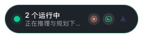
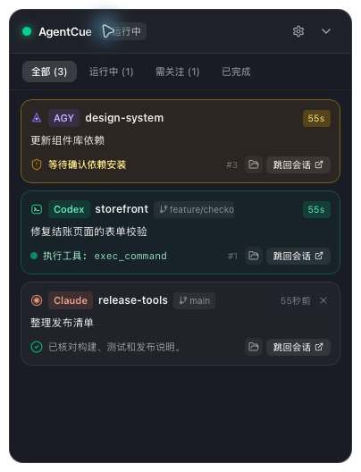
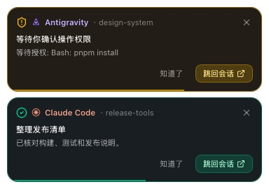

# AgentCue

跨平台（**macOS + Windows**）轻量级 AI Coding Agent 悬浮进度胶囊与完成弹窗提醒工具，基于 **Tauri v2 + Rust + React + Tailwind CSS** 构建，统一监控 **Claude Code**、**Codex** 与 **Google Antigravity**。

[下载 AgentCue 安装包](https://github.com/Mucheen/AgentCue/releases/latest)

## 界面演示

悬浮胶囊显示正在运行的 Agent 数量，点击即可展开会话面板。



| 会话面板 | 桌面通知 |
| --- | --- |
|  |  |
| 查看当前步骤、运行时间和会话状态。 | 需要确认或任务结束时弹出提醒。 |

以上截图来自 macOS 版，画面使用示例会话数据。

## 安装与首次使用

| 平台 | 安装步骤 |
| --- | --- |
| macOS（Apple Silicon 和 Intel） | 打开 `AgentCue_*_universal.dmg`，将 `AgentCue.app` 拖到「应用程序」，再从「应用程序」启动。发布包使用临时签名，未经 Apple 公证。 |
| Windows x64 | 运行 `AgentCue_*_x64-setup.exe` 并按安装向导操作。发布包未签名。 |

更新前，可通过 macOS 菜单栏或 Windows 系统托盘中的「退出 AgentCue」退出当前版本，再安装新版本。

1. 打开 AgentCue，再在 Codex、Claude Code 或 Antigravity 中开始一项任务。AgentCue 会自动读取本机的会话记录，默认使用只读监听。
2. 单击桌面悬浮胶囊展开会话面板。用「运行中」「需关注」「已完成」筛选会话，查看项目、当前步骤和耗时。有工作目录的会话可以用文件夹按钮直接打开目录。
3. 默认的「自由悬浮胶囊」可以拖动并记住位置。点击面板右上角的齿轮可切换为「顶部居中灵动岛」。菜单栏或系统托盘也提供「显示 / 隐藏悬浮窗」和「重置悬浮窗位置」。

## 提醒与会话跳转

- **需要确认**时，例如 Agent 请求工具权限，AgentCue 显示待确认提醒。打开原会话后，在 Agent 客户端中完成审批。
- **任务结束**时，AgentCue 根据客户端记录显示完成或异常中断提醒。普通输出和工具进度只更新面板，同一阶段的会话保持原有顺序。
- 在齿轮设置中可选择通知位于右上角或右下角、切换提示音，并调整成功完成提醒的最小任务耗时。默认阈值是 5 秒，选择「每次」可看到短任务的完成提醒。

会话卡片和通知都提供「跳回会话」按钮。精确定位取决于客户端和会话来源。

| 会话来源 | 跳转方式 |
| --- | --- |
| Codex 桌面客户端 | 使用会话 ID 打开该桌面对话，需要已安装的 Codex 桌面客户端能够处理会话链接。 |
| Antigravity 桌面客户端（macOS） | 通过辅助功能定位并打开对应对话。前往「系统设置 → 隐私与安全性 → 辅助功能」启用「应用程序」中的 AgentCue，再重试跳转。重装后若仍提示授权，可核对列表中的 AgentCue 是否对应当前安装的应用。 |
| Claude Code、普通终端或 Antigravity IDE | 当前版本缺少精确跳转入口。会话记录含工作目录时，可从卡片打开项目文件夹。 |

## 会话数据与 Hook

只读监听从用户目录读取以下记录。会话采集和 Hook 转发在本机进行。

| 客户端 | 默认监听位置 |
| --- | --- |
| Codex | `~/.codex/sessions/` 下的 `rollout-*.jsonl` |
| Claude Code | `~/.claude/projects/` 下的会话 JSONL 文件 |
| Antigravity | `~/.gemini/antigravity/` 下的会话摘要数据库和 `transcript.jsonl` |

如果需要更及时地接收客户端事件，打开会话面板右上角的齿轮，在相应客户端旁点击「一键接入」。AgentCue 会备份已有配置到 `~/.agent-ing/backups/`，保留已有第三方 Hook，并使用 `agent-ing-hook` 将事件转发到本机 `127.0.0.1`。Codex 首次接入后，在 Codex 终端运行 `/hooks` 信任新增 Hook。需要关闭时，在同一设置页点击「安全移除」，即可继续使用只读监听。

刚启动时载入的历史任务只显示在面板里。若列表为空，可先在受支持的客户端发起新任务，再检查该客户端是否在上述位置生成了本地会话记录。

## 本地开发与构建

开发依赖包括 Node.js、pnpm、Rust 和对应平台的编译工具。macOS 悬浮窗使用非激活的 `NSPanel`，Windows 悬浮窗使用 `WS_EX_NOACTIVATE | WS_EX_TOOLWINDOW`。macOS 的窗口实现使用了 [agent-hud-open 的 tao 补丁](https://github.com/jazzenchen/tao/tree/e5c8659a4b91a44e806bafcd63ece1f11fcba503)。

### 安装依赖、启动和测试

```bash
pnpm install --frozen-lockfile
pnpm tauri dev
pnpm run typecheck
cargo test --locked --manifest-path src-tauri/Cargo.toml
```

如果终端找不到 `cargo`，先将 Rust 的 `bin` 目录加入 `PATH`。

### 生成安装包

macOS 通用包包含 Apple Silicon 和 Intel 两种架构，输出在 `src-tauri/target/universal-apple-darwin/release/bundle/`。

```bash
rustup target add aarch64-apple-darwin x86_64-apple-darwin
APPLE_SIGNING_IDENTITY=- pnpm tauri build --target universal-apple-darwin --bundles app,dmg
```

在 Windows 开发机上运行以下命令，NSIS 安装包输出在 `src-tauri/target/x86_64-pc-windows-msvc/release/bundle/nsis/`。

```powershell
rustup target add x86_64-pc-windows-msvc
pnpm tauri build --target x86_64-pc-windows-msvc --bundles nsis
```
